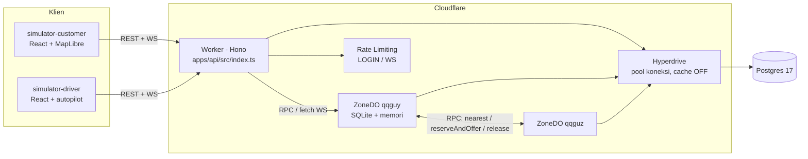
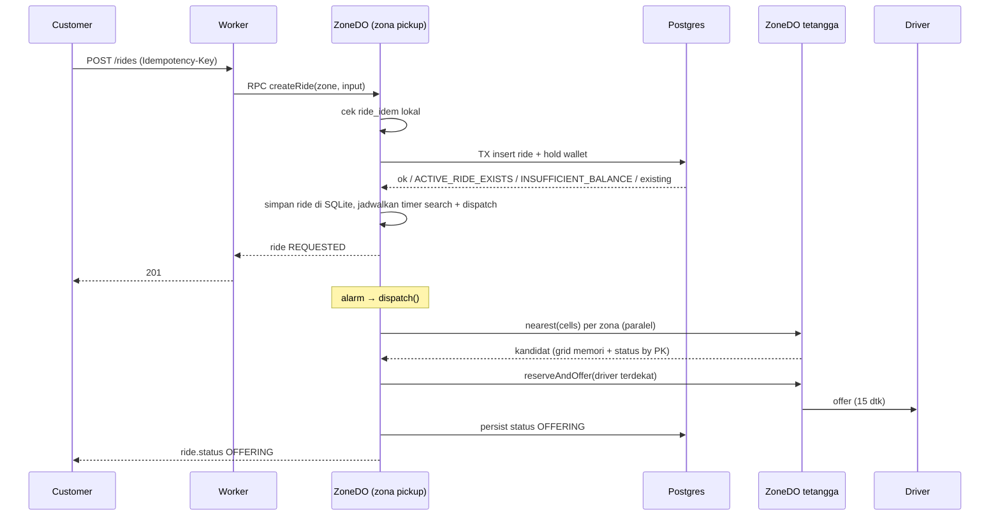

# Review Arsitektur — kondisi setelah Tahap 1 & 2

Tanggal: 2026-11-14 · Branch: `feat/cloudflare-backend` (belum di-commit)
Versi ringkas untuk pemula ada di [ARCHITECTURE.md](ARCHITECTURE.md); rencana lanjutan di [TODO.md](TODO.md).

Dokumen ini menjelaskan **cara kerja sistem saat ini secara teknis** (berdasarkan kode, bukan rencana),
lalu mencatat **temuan review**: apa yang sudah kuat, apa yang masih berisiko, dan apa yang perlu dikerjakan.

---

## 1. Komponen



| Komponen | File | Peran | State |
|---|---|---|---|
| Worker | `apps/api/src/index.ts` | auth JWT, validasi input, rate limit, routing ke zona, REST baca dari Postgres | stateless |
| ZoneDO | `apps/api/src/zone.ts` | single writer semua driver & ride di satu geohash-5 (±5 km): matching, offer, state machine ride, timer, WebSocket | memori + SQLite DO |
| Postgres | `apps/api/migrations/0001_init.sql`, `src/db.ts` | user, riwayat ride, wallet, ledger, hold, daftar zona; **penjamin invariant global** | durable |
| core | `packages/core` | logika murni: geohash, matcher, tarif, state machine, settlement, presence/throttle | — |
| client | `packages/client` | REST client, `RideSocket` (reconnect, zone hand-over, `known=1`), protokol | — |

---

## 2. Model data: siapa pemilik apa

| Data | Pemilik (source of truth) | Salinan | Ditulis kapan |
|---|---|---|---|
| Posisi driver | **memori ZoneDO** (`pos` Map + `grid` Map<cell6, Set>) | snapshot SQLite DO tiap ≥30 dtk | tiap ping yang lolos throttle (memori saja) |
| Status driver (OFFLINE/AVAILABLE/RESERVED/ON_RIDE), offer, reservasi | SQLite ZoneDO `drivers` | — | tiap perubahan status |
| Ride yang sedang jalan + antrean kandidat + timer | SQLite ZoneDO `rides`, `timers` | Postgres `rides` (write-through) | tiap transisi |
| Ride selesai > 1 jam | Postgres | — | dihapus dari DO oleh `purge` |
| User, kendaraan | Postgres | info driver di JWT & baris DO | login |
| Saldo, ledger, hold | Postgres (`wallets`, `wallet_transactions`, `wallet_holds`) | — | create ride, topup, settle, cancel |

Invariant yang **dijamin Postgres** (bukan DO):
- `one_active_ride` — satu ride aktif per customer, lintas zona.
- `one_active_ride_driver` — satu ride ACCEPTED/ARRIVED/ON_TRIP per driver.
- `rides_idem` — idempotency `POST /rides` per customer.
- `UNIQUE(ride_id, user_id, type)` + `paid_at IS NULL` — settlement tidak dobel.
- `UNIQUE(user_id, idempotency_key)` — topup tidak dobel.
- Saldo tersedia = `balance − SUM(hold ACTIVE)` dicek di bawah `FOR UPDATE` saat create ride WALLET.

Invariant yang **dijamin ZoneDO** (single-threaded actor):
- Satu driver hanya di-reserve oleh satu ride pada satu waktu (`reserveAndOffer` hanya dari AVAILABLE / reservasi kedaluwarsa).
- Transisi ride lewat `applyRideEvent` (core) — duplikat = no-op.

---

## 3. Alur utama

### 3.1 Login & koneksi WebSocket

1. `POST /auth/login` → rate limit per IP (`LOGIN_LIMITER` 20/menit) → upsert user (`ON CONFLICT (phone)`) → JWT berisi `sub`, `role`, `name`.
2. `GET /ws?token=…` di Worker (`index.ts:95`):
   - verifikasi JWT (tanpa DB; `getUser` hanya bila `DEV_RESET=1`), rate limit per user (`WS_LIMITER` 30/menit).
   - tentukan zona: `rideId` (prefix ID ride = zona) → `zone` eksplisit → lookup ride aktif di Postgres **hanya jika `known≠1`** → `lat/lng` → 400.
   - teruskan upgrade ke `ZoneDO.fetch` dengan header `x-zone`, `x-user-id`, `x-role`, `x-lat/lng`.
3. `ZoneDO.fetch` (`zone.ts:837`): tutup socket lama user (4000 "replaced"), `acceptWebSocket` dengan tag `user:<id>` (hibernation API), buat/ambil baris driver, kirim `hello {driverStatus, rideId}`.
4. Klien (`socket.ts`) mencatat `known` + `rideId` dari `hello`; reconnect berikutnya pakai `known=1` dan jitter (0,5–5 dtk untuk kode 1001/1006/1012).

### 3.2 Pesan ride



Detail matching (`findCandidates`, `zone.ts:642`):
- Ring presisi `[6, 5]`: geohash-6 pickup + 8 tetangga dulu; kalau kosong, geohash-5 + 8 tetangga.
- Sel dikelompokkan per zona pemilik → `nearest` dipanggil paralel ke tiap ZoneDO (termasuk diri sendiri tanpa RPC).
- `nearest` (`zone.ts:460`) baca `grid` di memori, lalu status driver by primary key; filter: socket tersambung, ping < 30 dtk (`staleMs`), AVAILABLE atau reservasi kedaluwarsa, ≤ 5 km. Top-10 terdekat (jarak lurus/haversine).
- Offer **berurutan**: satu driver per kali. Tolak / diam 15 dtk → driver masuk `rejected`, lanjut kandidat berikutnya. Antrean habis → cari ulang sekali setelah 5 dtk. Batas total 120 dtk → `NO_DRIVER`.

### 3.3 Terima offer & perjalanan

1. Driver kirim `offer.accept` ke zona tempat ia berada → RPC `acceptOffer` ke zona ride.
2. Zona ride: validasi offer masih milik driver & belum kedaluwarsa → `ACCEPTED`, baris driver dipindah ke zona ride dengan status `ON_RIDE`, persist ke Postgres.
3. Jika zona ride ≠ zona driver: zona asal hapus baris driver, kirim `zone.moved` + tutup 4001 → klien reconnect ke zona ride. **Selama trip customer & driver tersambung ke DO yang sama**, jadi `driver.loc` diteruskan langsung tanpa RPC.
4. `ride.arrived` → `ride.start` → `ride.complete`: tiap transisi `saveRide` (SQLite) → `persist` (Postgres) → broadcast `ride.status`.
5. `COMPLETE` → `settleRide` (satu transaksi Postgres): lock ride + dua wallet (urut `user_id`), tulis ledger, capture/release hold, set `paid_at`. Driver kembali AVAILABLE (atau OFFLINE bila saldo < `DRIVER_MIN_BALANCE`).

### 3.4 Lokasi driver (jalur paling panas)

```
klien: kirim bila gerak ≥30 m atau ≥5 dtk (shouldSendPing)
  → ZoneDO "loc": acceptPing (≥2 dtk, ON_RIDE ≥1 dtk, atau gerak ≥30 m) — selain itu dibuang
  → setPos (memori + pindah sel grid)
  → snapshot ke SQLite hanya bila ≥30 dtk sejak snapshot terakhir
  → ON_RIDE: teruskan driver.loc ke customer
  → selain itu: maybeHandOff (hysteresis: >100 m masuk zona baru atau 3 ping berturut di luar)
```

Biaya per ping: 0 tulis storage di jalur normal, 0 RPC, 0 query Postgres.

### 3.5 Timer

Semua timer (`dispatch:`, `offer:`, `search:`, `purge:all`) disimpan di tabel `timers` dan di-multiplex ke **satu alarm DO**.
`alarm()` mengelompokkan timer jatuh tempo per ride → ride berbeda jalan paralel (maks 16), timer satu ride berurutan.
Waktu alarm berikutnya di-cache di memori (`nextAlarm`) supaya `schedule()` tidak selalu `getAlarm()`.

### 3.6 Batal

`POST /rides/:id/cancel` → Worker → `cancelRide` di zona ride: transisi `CANCEL`, hapus timer, bebaskan driver,
persist (Postgres juga me-release hold), lalu `release` offer yang sedang berjalan di zona driver.

---

## 4. Yang sudah kuat

- **Invariant uang & ride aktif ada di Postgres**, bukan di memori aktor — race dua zona (dua `POST /rides` paralel) ditutup oleh partial unique index, ada test-nya.
- **Settlement idempotent dan atomik**: lock baris ride + wallet berurutan (tidak deadlock), ledger dengan unique key, `balance == SUM(ledger)` per user.
- **Jalur ping murah**: tidak ada tulis storage, query, atau RPC per ping — aturan biaya di TODO.md terpenuhi.
- **Matching tanpa full scan**: grid memori + PK lookup.
- **Reconnect storm tidak menyentuh Postgres** di jalur `/ws` (`known=1` + JWT-only).
- **Single writer per zona** membuat reservasi driver bebas race tanpa lock eksplisit.
- **Logika domain murni di `core`** (matcher, tarif, state machine, presence) — mudah dites, dipakai server & klien.

---

## 5. Temuan review (urut dari paling berisiko)

### ✅ R1. DO dan Postgres bisa tidak sinkron permanen bila write Postgres gagal — **diperbaiki**

> **Perbaikan (2026-11-14):**
> - Write-through ride lewat **outbox** di SQLite DO (`outbox`, satu baris per ride, state terbaru + `version`).
>   `persist()` mencatat ke outbox dalam langkah sinkron yang sama dengan `saveRide`, lalu langsung flush;
>   gagal → timer `outbox:<rideId>` retry dengan backoff 2 s → 60 s. Flush per ride diserialkan (urutan terjaga),
>   `persist()` tidak pernah melempar lagi.
> - `createRide` **write-ahead**: ride disimpan di DO sebagai `pgPending` + timer `create:` **sebelum** insert Postgres.
>   Insert gagal/hasil tak pasti → `recoverCreate` cek Postgres: ada → dispatch, tidak ada → buang.
>   Retry dengan Idempotency-Key yang sama langsung menjalankan recovery. Error DB → `503 UNAVAILABLE` (bukan throw lewat RPC).
> - Postgres menolak write yang menghidupkan lagi ride terminal (`WHERE rides.status NOT IN (COMPLETED, CANCELLED, NO_DRIVER)`).
> - `purge` tidak menghapus ride yang masih punya outbox atau belum dibayar.
> - Test: `apps/api/test/resilience.test.ts` (outage disimulasikan lewat seam `ZoneDO.pg`).
>
> Sisa: belum ada job rekonsiliasi lintas sistem (mis. DO zona dihapus manual) — tetap layak sebagai cron nanti.

Pola di semua transisi: `saveRide()` (SQLite DO) **dulu**, baru `await persist()` (Postgres), tanpa retry.

Skenario konkret:
- `cancelRide` (`zone.ts:744`): ride sudah `CANCELLED` di SQLite, timer dihapus, lalu `persist` gagal (Postgres/Hyperdrive timeout) → RPC melempar → Worker 500. Customer coba batal lagi → transisi duplikat = no-op → **tidak pernah persist**. Di Postgres ride tetap aktif → `one_active_ride` **memblokir customer selamanya** dan hold wallet tidak pernah dilepas.
- `noDriver` (`zone.ts:662`): timer `search/offer/dispatch` dihapus **sebelum** `persist` → gagal sekali = tidak ada percobaan ulang → efek sama.
- `createRide` (`zone.ts:560-566`): insert Postgres sukses, lalu DO di-evict/crash sebelum `saveRide` → ride + hold yatim di Postgres, tidak ada aktor yang menjalankannya → customer terblokir.

Saran: tabel `outbox` di SQLite DO yang ditulis **dalam operasi sinkron yang sama** dengan `saveRide`, di-flush oleh alarm dengan retry (ini persis TODO #15, tapi alasannya **kebenaran**, bukan hanya performa). Ditambah job rekonsiliasi: ride aktif di Postgres yang tidak ada di DO > N menit → tanyakan ke zona / tandai `CANCELLED` + release hold.

### ✅ R2. Settlement gagal membuat driver macet di `ON_RIDE` — **diperbaiki**

> **Perbaikan (2026-11-14):** saat `COMPLETE`, timer `settle:<rideId>` dijadwalkan (durable) sebelum apa pun bisa gagal.
> Driver **selalu dibebaskan** setelah percobaan pertama, berhasil atau tidak. Gagal → retry dengan backoff sampai `paidAt` terisi,
> lalu `ride.paid` dikirim ke kedua pihak; aturan saldo minimum driver diterapkan saat itu bila driver sedang idle.
> `ride.complete` duplikat memicu ulang settlement yang belum selesai. Percobaan inline dan timer tidak tumpang tindih (`settling`).

`driverRideEvent` (`zone.ts:787`): `COMPLETE` disimpan & di-persist, baru `completeRide` → `settleRide`. Jika settle gagal (DB error), exception naik; driver **tidak dibebaskan** (`setDriverFree` ada setelah settle). Driver kirim `ride.complete` lagi → transisi duplikat → `return` sebelum `completeRide` → **settle tidak pernah dicoba ulang**, driver tidak bisa online/offline (`DRIVER_BUSY`).

Saran: pisahkan "ride selesai" dari "ride dibayar": jadwalkan timer `settle:<rideId>` yang di-retry sampai `paid_at` terisi; `ride.complete` duplikat memicu ulang settle bila `paidAt === null`.

### 🟠 R3. `online` setelah hand-over/reconnect selalu query Postgres

Klien driver mengirim `online` di setiap `hello` (`apps/simulator-driver/src/App.tsx:112`). Handler `online` (`zone.ts:941`) selalu `getBalance` + (bila zona baru) `getVehicle`. Jadi klaim "reconnect = 0 query" hanya benar untuk `/ws`; **badai reconnect saat deploy tetap menghasilkan 1–2 query per driver online**, dan setiap hand-over zona juga.

Saran: driver yang sudah AVAILABLE di zona lama dibawa statusnya (header/zona tujuan menerima `status`+`vehicle` dari JWT atau dari pesan hand-over), dan cek saldo cukup dilakukan saat go-online pertama atau di-cache beberapa menit.

### 🟠 R4. Hot spot: satu zona = satu thread untuk semua hal

Ride dimiliki zona **pickup** sampai selesai. Mall/stasiun/bandara memusatkan: semua ping driver ON_RIDE, semua offer, semua timer, semua write-through Postgres pada satu DO. Alarm paralel (#12) membantu interleaving I/O, tapi CPU tetap satu thread. Ini TODO #16 (RideShardDO). Belum terukur — butuh load test #14.

### 🟠 R5. Client Postgres dibuat per operasi di DO

`withDb` (`pg.ts:22`) membuat client `postgres()` baru dan menutupnya per operasi. Hyperdrive memang mem-pool koneksi ke Postgres, tapi tiap operasi tetap membayar handshake Worker↔Hyperdrive. Di DO yang hidup lama, satu client yang dipakai ulang (dengan reconnect saat error) lebih murah dan lebih cepat. Perlu diukur di load test sebelum diubah.

### 🟡 R6. Dispatch berurutan & jarak lurus

- Offer satu-per-satu dengan timeout 15 dtk → skenario terburuk 10 kandidat menolak diam = 150 dtk > batas 120 dtk.
- Ranking pakai haversine (jarak lurus); sungai, tol, satu arah di Jakarta membuat "terdekat" sering salah. Rencana: routing-svc + batch matching (TODO #17–18).

### 🟡 R7. Pemulihan setelah DO di-evict

- Posisi memori hilang; dibangun ulang dari snapshot (bisa 30 dtk basi). Aman karena `staleMs` 30 dtk menyaring driver basi sampai ping berikutnya, tapi selama itu zona terlihat "kosong" → bisa ada `NO_DRIVER` palsu tepat setelah restart (search ulang 5 dtk membantu).
- `dispatching` (Set di memori) hilang saat evict — aman, karena state antrean ada di SQLite dan timer memicu ulang.

### 🟡 R8. Hysteresis menyembunyikan driver di pita batas

Driver AVAILABLE yang sudah melewati batas zona tetap terdaftar di zona lama sampai hysteresis terpenuhi (≤ ~15 dtk). Pencarian dari zona baru tidak menemukannya **kecuali** sel pencarian kebetulan jatuh ke zona lama (ring geohash-5 + tetangga biasanya mencakup, jadi dampaknya kecil). Tercatat di TODO #11.

### 🟡 R9. Keamanan & operasional

- JWT tanpa pencabutan (user dihapus/diblokir tetap bisa konek sampai token kedaluwarsa) — sah untuk POC, perlu `jti` blocklist di KV untuk produksi.
- Rate limit login fallback key `"local"` bila header `cf-connecting-ip` tidak ada — di produksi header selalu ada, aman; di dev semua request berbagi satu kuota.
- Login tanpa OTP; topup dummy (sudah tercatat sebagai batasan POC).
- Belum ada metrik/observability khusus (latensi offer, umur alarm, error persist). `observability.enabled` hanya log.

### ⚪ R10. Kebersihan kode

- Komentar basi menyebut D1: `zone.ts:190` ("record this zone actor in D1"), `index.ts:132` ("Wipes ALL data (D1 + …)").
- Header komentar `// hot store: drivers` muncul dua kali di `zone.ts` (358 & 388).
- Kolom `cell` + index `drivers_cell` di SQLite DO tidak dipakai lagi oleh `nearest` (grid memori) — bisa dihapus atau dipakai untuk rebuild grid.
- Tabel `ride_idem` di DO duplikat dengan `rides_idem` di Postgres; masih berguna sebagai jalur cepat, tapi `purge` menghapusnya setelah 1 jam — setelah itu retry idempotent jatuh ke Postgres (`res.existing`), hasilnya tetap benar.

---

## 6. Prioritas tindakan

| # | Tindakan | Menutup | Effort |
|---|---|---|---|
| 1 | ✅ Outbox SQLite DO + flush alarm dengan retry untuk semua write-through ride | R1 | M |
| 2 | ✅ Settle sebagai timer yang di-retry sampai `paid_at`; `ride.complete` duplikat memicu ulang | R2 | S |
| 3 | ✅ Write-ahead `createRide` + recovery (pengganti rekonsiliasi untuk kasus ride yatim); cron rekonsiliasi umum masih opsional | R1 | S–M |
| 4 | Load test baseline (TODO #14): ukur latensi offer, rows written, query Postgres per reconnect | R3–R5 | M |
| 5 | Bawa status driver saat hand-over / cache saldo untuk `online` | R3 | S |
| 6 | Bersihkan komentar D1 & kolom `cell` yang tak terpakai | R10 | XS |
| 7 | RideShardDO, routing-svc, batch matching — hanya bila #4 menunjukkan perlu | R4, R6 | L |

Butir 1–3 sudah dikerjakan: gangguan Postgres singkat tidak lagi mengunci customer atau menahan saldo — state menyusul setelah Postgres pulih.
