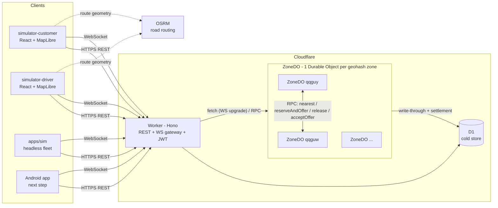
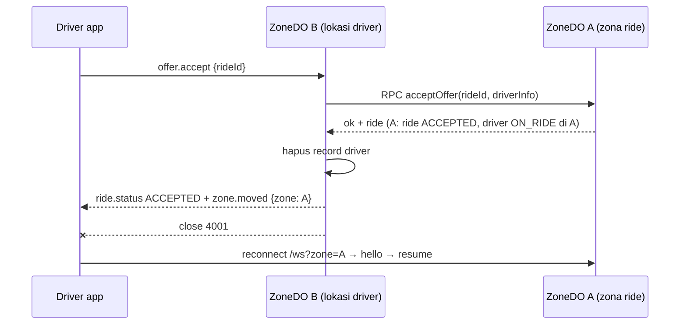
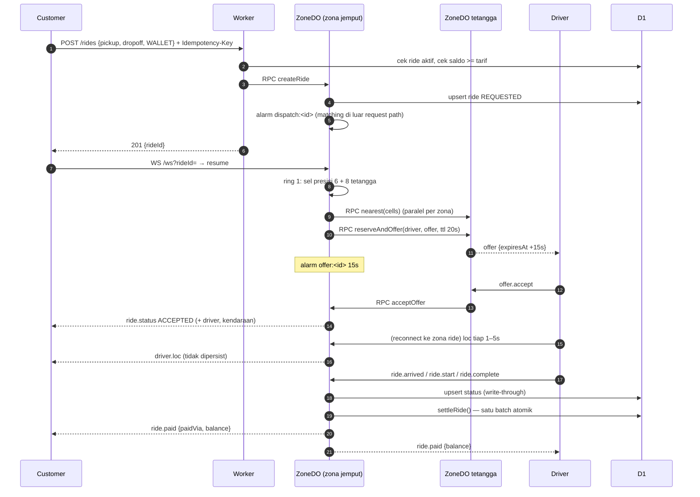

# Arsitektur — Ride-Hailing POC (Cloudflare)

Gambaran teknis implementasi [PLAN.md](PLAN.md) di stack Cloudflare. Cara menjalankan ada di [README.md](README.md).

## 1. Gambaran besar



| Peran (PLAN §7) | Implementasi | Lokasi |
|---|---|---|
| API Gateway | Cloudflare Worker + Hono: auth JWT, validasi, routing WebSocket ke zona | `apps/api/src/index.ts` |
| Zone Actor / Dispatcher | `ZoneDO` — Durable Object per zona geohash, single writer | `apps/api/src/zone.ts` |
| Hot store | SQLite di dalam tiap ZoneDO (driver, ride aktif, timer, idempotency) | `ZoneDO.initSchema()` |
| Cold store | D1: users, vehicles, rides, wallets, wallet_transactions, zones | `apps/api/migrations/` |
| Timer | Satu DO alarm per zona, multiplexing tabel `timers` | `ZoneDO.alarm()` |
| WebSocket | DO Hibernation API (`acceptWebSocket`, tag `user:<id>`, auto-response ping) | `ZoneDO.fetch()` |
| Logika murni | geohash, haversine, matcher, state machine, tarif, settlement | `packages/core` |
| Kontrak client | tipe pesan, REST client, WS client (reconnect + zone hand-over), routing OSRM | `packages/client` |

## 2. Monorepo (Turborepo + pnpm)

```
packages/core      ← tanpa I/O, dipakai backend & frontend
   ▲      ▲
   │      └──────────── packages/client  ← protocol types, ApiClient, RideSocket, route, React UI
   │                        ▲      ▲      ▲
apps/api ───────────────────┘      │      │   (api hanya import protocol types)
apps/simulator-customer ───────────┘      │
apps/simulator-driver ────────────────────┘
apps/sim   (headless fleet, pakai core)
apps/e2e   (Playwright, mengendalikan kedua simulator)
```

Turbo task: `typecheck`, `test`, `build`, `dev`. `pnpm dev` = API + dua simulator; `pnpm test` = unit core + integrasi API (workerd sungguhan); `pnpm e2e` = Playwright.

## 3. Zona & sharding

- Bumi dibagi ke sel geohash. **Satu zona = satu `ZoneDO`**, nama DO = geohash dengan presisi `ZONE_PRECISION` (default 5 ≈ 4,9 × 4,9 km).
- **ID ride membawa zonanya**: `<zone>_<uuid>` (mis. `qqguy_9572…`). Komponen mana pun bisa langsung route ke pemilik ride tanpa lookup.
- Zona yang pernah aktif dicatat di D1 `zones` (untuk ops dan dev reset).
- Scale-out = tambah presisi zona (lebih banyak actor, masing-masing lebih sedikit driver). Target ~1–3k driver/zona.

### Siapa tinggal di zona mana

| Kondisi | Socket & record driver ada di |
|---|---|
| Driver OFFLINE/AVAILABLE/RESERVED | zona tempat lokasinya berada |
| Driver ON_RIDE | **zona ride** (zona titik jemput) sampai ride selesai |
| Customer dengan ride aktif | zona ride |

Jadi selama ride aktif, **customer, driver, dan state ride ada di satu actor** → event perjalanan & stream lokasi tidak perlu lompat antar-DO.



Driver AVAILABLE yang bergerak keluar zona juga menerima `zone.moved` dan reconnect berdasarkan lokasi (`RideSocket` menangani ini otomatis).

## 4. Alur ride end-to-end



### Matching (PLAN §5)

1. **Ring**: sel geohash presisi 6 (~±1,2 km) + 8 tetangga; jika kosong, presisi 5 (~±5 km). Radius maks 5 km, top k = 10.
2. Sel dikelompokkan per zona → `nearest()` ke tiap zona **paralel** (zona sendiri = panggilan lokal).
3. Filter (`rankCandidates` di core): AVAILABLE (atau RESERVED yang reservasinya kedaluwarsa), ping < 30 s, socket terhubung, belum menolak ride ini.
4. **Tawaran berurutan**: `reserveAndOffer` atomik di zona driver (single writer → satu driver tidak bisa dapat dua ride). Gagal → kandidat berikutnya.
5. Tolak/timeout 15 s → `release` → kandidat berikutnya. Antrean habis → cari ulang sekali setelah `RESEARCH_DELAY_MS` → `NO_DRIVER`. Batas total `SEARCH_TIMEOUT_MS` (2 menit).

### State machine (PLAN §4)

`applyRideEvent(status, event)` di `packages/core` — murni, menolak transisi tidak valid (`INVALID_TRANSITION`), dan event duplikat jadi no-op (idempotent). Status driver: `OFFLINE → AVAILABLE ⇄ RESERVED → ON_RIDE → AVAILABLE`.

## 5. Data

### Hot store (SQLite per ZoneDO)

| Tabel | Isi |
|---|---|
| `drivers` | lokasi, sel geohash, status, reservasi, tawaran aktif (soft state; tidak masuk D1) |
| `rides` | ride aktif + internal dispatch (antrean kandidat, daftar penolak, tawaran berjalan) sebagai JSON |
| `timers` | `dispatch:` `offer:` `search:` `purge:` → satu DO alarm |
| `ride_idem`, `meta` | idempotency order, nama zona |

Disimpan di SQLite (bukan memori) supaya selamat dari hibernasi/eviksi DO. Ride terminal & driver idle dibersihkan oleh timer `purge`.

### Cold store (D1)

`users`, `vehicles`, `rides` (write-through setiap transisi), `wallets`, `wallet_transactions` (append-only), `zones`. Skema: `apps/api/migrations/`.

## 6. Wallet & settlement (PLAN §6)

`settleRide()` (`apps/api/src/db.ts`) = **satu `D1.batch()`** (atomik):

```
WALLET:  INSERT RIDE_PAYMENT  … WHERE balance >= fare AND rides.paid_at IS NULL
         UPDATE wallet customer  WHERE EXISTS(baris ledger milik run ini)
         INSERT RIDE_EARNING     WHERE EXISTS(RIDE_PAYMENT run ini)
         UPDATE wallet driver    WHERE EXISTS(baris ledger milik run ini)
CASH / fallback:
         INSERT COMMISSION       WHERE paid_at IS NULL AND tidak ada RIDE_PAYMENT
         UPDATE wallet driver    WHERE EXISTS(baris ledger milik run ini)
SELALU:  UPDATE rides SET paid_via, paid_at WHERE paid_at IS NULL
```

- **Idempotent**: guard `paid_at IS NULL` + `UNIQUE(ride_id, user_id, type)` → settlement dobel tidak memotong dua kali.
- **Invariant** `wallets.balance == SUM(wallet_transactions.amount)`: setiap update saldo hanya jalan jika baris ledger run itu benar-benar masuk.
- Saldo kurang saat selesai → otomatis **fallback CASH** (driver bayar komisi).
- Top-up memakai `Idempotency-Key` (`UNIQUE(user_id, idempotency_key)`), pola guard yang sama.
- Driver dengan saldo < `DRIVER_MIN_BALANCE` tidak bisa online.

## 7. Protokol real-time

`/ws?token=…` lalu `{ "t": "<type>", … }` (PLAN §9.2). Tambahan dari implementasi:

| Pesan | Arah | Fungsi |
|---|---|---|
| `hello {zone, role, driverStatus?, rideId?}` | S→C | pertama setelah connect; client lalu kirim `resume` |
| `driver.state {status, rideId}` | S→driver | status driver otoritatif |
| `zone.moved {zone, rideId?}` | S→C | hand-over zona; client reconnect ke zona itu |
| close code `4001` / `4002` | S→C | pindah zona / simulator di-reset (client logout) |

`{"t":"ping"}` dijawab oleh runtime (auto-response) tanpa membangunkan DO yang sedang hibernasi.

`RideSocket` (`packages/client/src/socket.ts`): reconnect exponential backoff, ikut `zone.moved`, keepalive 20 s, `onReset` untuk 4002.

## 8. Simulator & routing

- **simulator-customer / simulator-driver**: dua app terpisah (port berbeda → sesi/localStorage terpisah, bisa dibuka berdampingan).
- **Fokus peta per fase**: rencana = rute penuh; penjemputan = driver → titik jemput saja; perjalanan = driver → tujuan saja.
- **Routing jalan**: `packages/client/src/route.ts` memanggil OSRM (default server publik, bisa diganti `VITE_OSRM_URL`, `off` untuk test). Autopilot driver bergerak sepanjang polyline jalan; fallback garis lurus bila OSRM gagal. Tarif backend tetap haversine × 1,3 (PLAN §5.5).
- **Reset**: tombol 🔄 → `POST /dev/reset` (hanya aktif jika `DEV_RESET=1`) → kosongkan D1 + `ZoneDO.reset()` untuk setiap zona terdaftar.
- **apps/sim**: armada driver headless (N driver, auto-accept probabilistik) untuk beban & demo.
- **apps/e2e**: langkah UI dipakai bersama oleh test Playwright dan `demo:live` / `demo:record`.

## 9. Testing

| Lapisan | Alat | Cakupan |
|---|---|---|
| Unit | Vitest | geohash/tetangga, haversine, tarif, ranking kandidat, semua transisi state machine, settlement |
| Integrasi | Vitest + `@cloudflare/vitest-plugin` (workerd, DO, D1 sungguhan) | alur ride penuh, timeout tawaran, rebutan driver, cross-zone hand-over, cancel, wallet idempotent & fallback, invariant ledger, reset |
| E2E | Playwright (dua browser context) | ride wallet + rating, tolak → NO_DRIVER, cancel saat tawaran, reload driver di tengah ride, saldo kurang, reset logout jendela lain |

## 10. Trade-off & batasan POC

- **Matching lintas zona = RPC** ke ≤ 9 zona per ring; latensi beberapa ms antar-DO, cukup untuk POC.
- **Write-through ke D1 di setiap transisi** menambah satu round-trip per event; sederhana dan membuat riwayat selalu konsisten.
- **Harga fixed upfront** dari jarak garis lurus × 1,3, bukan jarak jalan OSRM.
- **Auth tanpa OTP**; JWT HS256 dengan `JWT_SECRET`.
- **OSRM publik** hanya untuk demo (rate-limit, koordinat keluar ke pihak ketiga) → self-host untuk produksi.
- Di luar scope (lihat PLAN §1): payment gateway, surge/promo, chat, KYC, batch matching.
