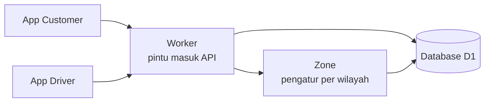
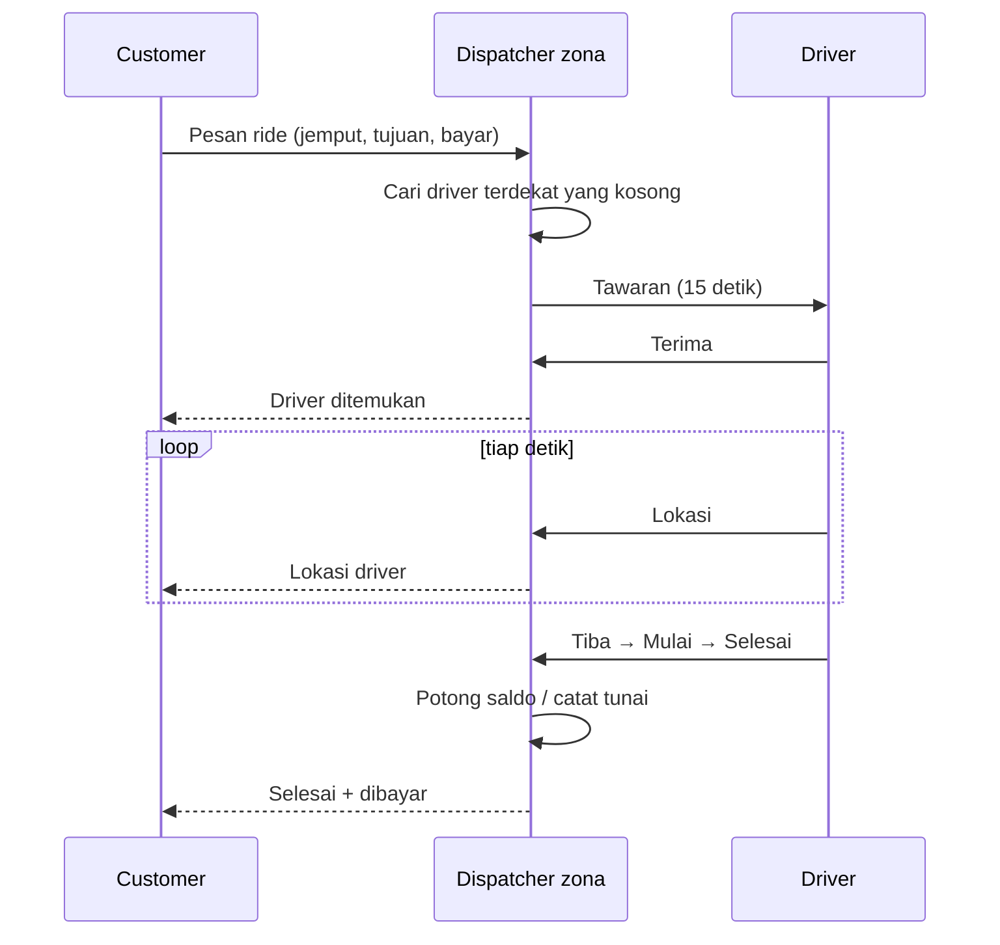

# Arsitektur (versi singkat)

Detail kebutuhan ada di [PLAN.md](PLAN.md), cara menjalankan di [README.md](README.md).

## 1. Satu gambar



Hanya ada **3 bagian** di server:

| Bagian | Analogi | Tugas |
|---|---|---|
| **Worker** | resepsionis | cek login, terima request, arahkan ke zona yang tepat |
| **Zone** (Durable Object) | dispatcher wilayah | tahu posisi semua driver di wilayahnya, cari driver, kirim tawaran, pantau perjalanan |
| **D1** | arsip | simpan user, riwayat ride, saldo wallet |

## 2. Kenapa dibagi per zona?

Jakarta dibagi jadi kotak-kotak ±5 km (pakai *geohash*). **Tiap kotak punya satu "dispatcher" sendiri** (satu Durable Object).

- Dispatcher bekerja **satu per satu** (tidak paralel di dalam dirinya), jadi satu driver tidak mungkin dapat dua order sekaligus. Tanpa perlu lock.
- Kota makin ramai → kotak diperkecil → dispatcher bertambah. Itu cara scale-nya.
- ID ride menyimpan nama zonanya (`qqguy_…`), jadi server langsung tahu dispatcher mana yang pegang ride itu.

## 3. Alur satu perjalanan



Kalau driver **menolak atau diam 15 detik**, tawaran pindah ke driver terdekat berikutnya. Kalau tidak ada yang mau dalam 2 menit → "Driver tidak ditemukan".

Status ride:
`REQUESTED → OFFERING → ACCEPTED → ARRIVED → ON_TRIP → COMPLETED` (bisa `CANCELLED` sebelum jemput, atau `NO_DRIVER`).

## 4. Real-time

- App terhubung lewat **WebSocket** ke dispatcher zonanya.
- Saat ride berjalan, **customer dan driver terhubung ke dispatcher yang sama**, jadi lokasi driver langsung diteruskan ke customer.
- Kalau driver menerima order dari zona sebelah, server menyuruh app driver **pindah sambungan** ke zona ride (`zone.moved`). App melakukannya otomatis.
- Koneksi putus → app sambung ulang sendiri dan minta status terbaru.

## 5. Data disimpan di mana?

| Data | Tempat | Alasan |
|---|---|---|
| Posisi driver, ride yang sedang jalan | di dalam dispatcher zona | berubah tiap detik, harus cepat |
| User, riwayat ride, saldo & transaksi wallet | D1 (database) | harus permanen & konsisten |

Lokasi driver **tidak** disimpan ke database, karena terlalu sering berubah dan tidak perlu diarsipkan.

## 6. Wallet

- Saat ride **selesai**: bayar wallet → saldo customer dipotong, driver dapat tarif − komisi 20%. Bayar tunai → driver dipotong komisi.
- Semua langkah dijalankan dalam **satu transaksi**: semua berhasil, atau tidak ada yang berubah.
- Aman diulang: kalau proses pembayaran terpanggil dua kali, saldo **tidak** terpotong dua kali.
- Saldo customer kurang saat selesai → otomatis dianggap bayar tunai.

## 7. Kode-nya di mana

```
packages/core       logika murni: cari driver, hitung tarif, status ride, pembagian uang
packages/client     kode bersama untuk app: API, WebSocket, peta, rute jalan
apps/api            server: Worker + dispatcher zona + database
apps/simulator-*    app web customer & driver (untuk demo tanpa HP)
apps/e2e            test otomatis yang menjalankan kedua app (Playwright)
```

## 8. Batasan POC

- Tarif dihitung dari jarak lurus × 1,3, belum jarak jalan sebenarnya.
- Login tanpa OTP. Top-up wallet masih dummy.
- Rute jalan di simulator pakai server OSRM publik, hanya untuk demo.
- Belum ada payment gateway, promo, chat, atau verifikasi driver.

---

**Istilah:**
- *Durable Object*: "mini server" Cloudflare yang punya memori & penyimpanan sendiri dan menangani request satu per satu.
- *Geohash*: cara membagi peta jadi kotak-kotak berkode huruf.
- *D1*: database SQL Cloudflare.
