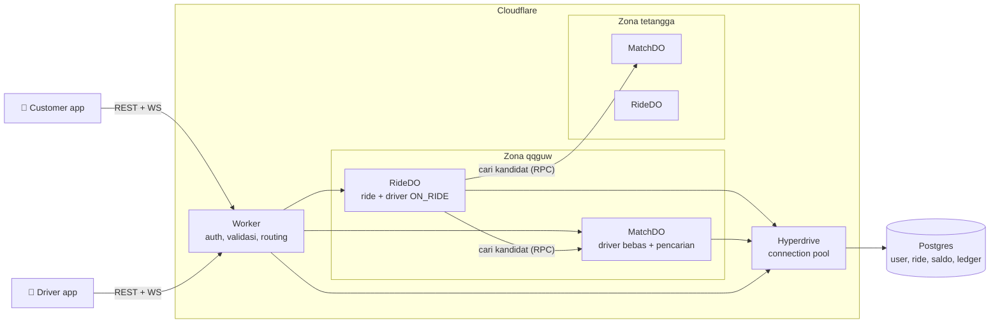
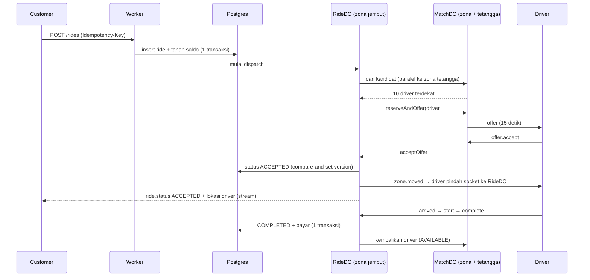

# Arsitektur Ride-Hailing di Cloudflare Durable Objects

> Bahan presentasi. Tiap bagian `##` kira-kira satu slide.
> Sumber: kode di `apps/api`, `packages/core`, plus [README.md](README.md), [PLAN.md](PLAN.md),
> [ARCHITECTURE-REVIEW.md](ARCHITECTURE-REVIEW.md), [TODO.md](TODO.md).

---

## 0. Ringkasan satu slide

- **Apa**: clone Gojek/Uber (customer pesan ojek, sistem cari driver terdekat, tracking real-time, bayar cash/wallet).
- **Bagaimana**: Cloudflare Workers + **Durable Objects (DO)** untuk bagian real-time, **Postgres** untuk uang dan data permanen.
- **Ide utama**: peta dibagi ke **zona** (geohash ±5 km). Tiap zona punya "petugas" (DO) sendiri yang memegang driver, mencari driver, dan mengurus ride di zona itu. Satu petugas = satu antrean = tidak ada rebutan data.
- **Kesimpulan**: DO sangat cocok untuk bagian *real-time + koordinasi per wilayah*. DO **tidak** cocok jadi satu-satunya database: uang dan aturan lintas zona tetap di Postgres.

---

## 1. WHAT — Produk apa yang dibangun

| Role | Bisa apa |
|---|---|
| Customer | Pilih jemput & tujuan, lihat tarif, pesan, lihat driver bergerak di peta, batal, bayar, rating, riwayat, wallet |
| Driver | Online/offline, kirim lokasi, terima/tolak tawaran 15 detik, Tiba → Mulai → Selesai, riwayat & pendapatan |
| Sistem | Cari driver terdekat, tawarkan satu per satu, cegah satu driver dapat dua ride, proses pembayaran tanpa dobel |

Status ride:

```
REQUESTED → OFFERING → ACCEPTED → ARRIVED → ON_TRIP → COMPLETED
                 └→ NO_DRIVER          └→ CANCELLED (sebelum ON_TRIP)
```

Isi repo (monorepo pnpm + Turborepo):

```
packages/core              logika murni: geohash, matcher, state machine, tarif, settlement (tanpa I/O)
packages/client            REST + WebSocket client, peta & UI React bersama
apps/api                   Worker + MatchDO + RideDO + Postgres (via Hyperdrive)
apps/simulator-customer    web app customer (React + MapLibre)
apps/simulator-driver      web app driver + autopilot
apps/e2e                   Playwright e2e + demo live
```

---

## 2. WHY HARD — Kenapa ride-hailing itu sulit

Bukan CRUD biasa. Empat masalah utama:

| # | Masalah | Contoh nyata |
|---|---|---|
| 1 | **Lokasi real-time dalam jumlah besar** | 10k driver ping tiap beberapa detik = ribuan tulisan/detik. Kalau semua ke database, database tumbang dan mahal. |
| 2 | **Rebutan driver (race condition)** | Dua customer pesan bersamaan, sistem menawari driver yang sama ke keduanya. |
| 3 | **Koneksi real-time** | Customer harus lihat motor bergerak; driver harus dapat tawaran dalam hitungan detik. Butuh WebSocket yang tahan reconnect. |
| 4 | **Uang harus benar** | Saldo tidak boleh terpotong dua kali, saldo tertahan harus kembali kalau batal, walau server/database sempat mati. |

Arsitektur "klasik" untuk ini biasanya: API server + **Redis** (lokasi, lock) + **Kafka** (event) + WebSocket gateway + Postgres + Kubernetes. Banyak bagian bergerak.

---

## 3. WHY DO — Apa itu Durable Object, dalam satu analogi

> **Durable Object = satu "petugas" dengan nama unik, meja sendiri, dan buku catatan sendiri.**

- **Nama unik**: `match:qqguw` selalu menunjuk ke petugas yang sama, di mana pun di dunia request datang.
- **Satu antrean**: petugas melayani satu pekerjaan dalam satu waktu (single-threaded). Tidak ada dua orang mengubah data yang sama bersamaan → **tidak perlu lock**.
- **Ingatan**: variabel di memori bertahan antar request (selama petugas "bangun").
- **Buku catatan**: SQLite bawaan per DO, transaksional, untuk data yang harus selamat kalau petugas tidur/restart.
- **Alarm**: petugas bisa pasang pengingat ("bangunkan aku 15 detik lagi").
- **WebSocket**: petugas bisa memegang koneksi socket langsung, dan bisa "tidur" tanpa memutus socket (*hibernation*).

Pemetaan ke masalah di slide 2:

| Masalah | Fitur DO yang menjawab |
|---|---|
| Lokasi real-time | Disimpan **di memori** DO zona, bukan database |
| Rebutan driver | Satu DO = satu antrean → reservasi otomatis atomik |
| Koneksi real-time | WebSocket langsung ke DO pemilik data, dengan hibernation |
| Timer tawaran 15 detik | Alarm DO |
| Uang | **Bukan** DO → Postgres (lihat slide 8) |

---

## 4. Gambaran besar arsitektur



| Komponen | File | Peran |
|---|---|---|
| **Worker** | `apps/api/src/index.ts` | Pintu masuk stateless. Cek JWT, validasi, rate limit, teruskan ke DO zona yang tepat. |
| **MatchDO** `match:<zona>` | `apps/api/src/match.ts` | Memegang driver bebas (`OFFLINE`/`AVAILABLE`/`RESERVED`) + posisi + grid geohash 6. Menjawab "siapa driver terdekat?" dan mereservasi driver. |
| **RideDO** `ride:<zona>[.k]` | `apps/api/src/ride.ts` | Memegang ride yang titik jemputnya di zona itu: dispatch, status, timer, rute, pembayaran. Juga socket customer dan driver yang sedang ride. |
| **Actor dasar** | `apps/api/src/actor.ts` | Bersama kedua DO: satu alarm untuk banyak timer, WebSocket hibernation, posisi driver, akses Postgres. |
| **Postgres** | `apps/api/src/db.ts` | Sumber kebenaran: user, ride, saldo, transaksi, saldo tertahan. |
| **Core** | `packages/core` | Logika murni (state machine, matcher, tarif, settlement), dites tanpa infrastruktur. |

---

## 5. Zona: cara membagi kota

- Kota dibagi ke sel **geohash presisi 5** (±5 km × 5 km). Satu sel = satu zona = sepasang DO.
- Nama DO dihitung dari koordinat, jadi **tidak perlu lookup**: lat/lng → geohash → `match:qqguw`.
- ID ride = `<zona>_<uuid>` → siapa pun tahu RideDO pemilik ride hanya dari ID-nya.
- Pencarian: sel geohash 6 + 8 tetangga dulu, lalu melebar ke geohash 5. Zona tetangga ditanya **paralel**. Maks 2 km, 10 kandidat terdekat.
- Driver yang melintas batas zona dipindah ke DO zona baru (`zone.moved`), dengan *hysteresis* (≥100 m masuk atau 3 ping di luar) supaya tidak bolak-balik.

```
┌───────┬───────┬───────┐
│ qqgut │ qqguv │ qqguy │   tiap kotak = MatchDO + RideDO sendiri
├───────┼───────┼───────┤
│ qqgus │ qqguw │ qqgux │   pesanan di qqguw → tanya qqguw + 8 tetangga
├───────┼───────┼───────┤
│ qqguk │ qqgum │ qqguq │
└───────┴───────┴───────┘
```

**Zona ramai** (mis. Sudirman jam pulang kantor): RideDO bisa di-*shard* lewat config `RIDE_SHARDS="qqguw=8,*=1"`. Ride dibagi ke 8 RideDO berdasarkan hash customer; semua shard tetap memakai satu MatchDO (satu kumpulan driver).

---

## 6. Alur satu ride



Poin penting:
- Tawaran **berurutan** satu driver per kali. Tolak/timeout → kandidat berikutnya.
- Saat ride berjalan, customer, driver, dan ride ada di **satu RideDO** → update lokasi ke customer tanpa lompatan antar server.
- Driver batal setelah terima → ride kembali dicari (`REQUEUE`), maks 3 kali.

---

## 7. Keputusan desain kunci

| Keputusan | Alasan |
|---|---|
| **Posisi driver di memori**, disalin ke SQLite DO tiap 30 detik | Satu ping tidak menulis apa pun. Menulis per ping ≈ **$5.000/bulan** untuk 10k driver (perkiraan di TODO.md). |
| **DO per zona, bukan per ride** | 1 DO per ride ≈ **$7.000/bulan** pada 100k ride/hari. Zona + shard tetap jauh lebih murah. |
| **Socket langsung ke DO pemilik data** | Ping lokasi tidak diteruskan lewat RPC antar-DO (mahal + menambah latensi). |
| **Dua DO per zona** (Match + Ride) | Pencarian driver (banyak baca, ringan) dipisah dari ride (berat, banyak timer). Ride bisa di-shard tanpa memecah kumpulan driver. |
| **Postgres dulu, baru DO** untuk status ride | Aturan lintas zona (satu ride aktif per customer/driver, saldo) hanya bisa dijaga satu database bersama. |
| **Satu alarm DO + tabel `timers`** | DO hanya punya satu alarm. Semua timer (`offer:`, `dispatch:`, `sync:`, `settle:`, `watch:`, …) dimultipleks di atasnya, dan dipasang ulang saat DO menyala. |
| **WebSocket hibernation** + auto-response ping/pong | DO boleh tidur saat sepi tanpa memutus socket → tidak bayar durasi untuk koneksi diam. |
| **`locationHint: apac`** | DO dibuat dekat region Postgres (Jakarta), supaya query dari DO cepat. |
| **Logika murni di `packages/core`** | State machine & matcher bisa dites tanpa Cloudflare, dan bisa dipindah ke platform lain. |

---

## 8. Kenapa uang tetap di Postgres

DO bagus untuk **satu zona**, tapi banyak aturan bersifat **lintas zona**:

- Customer pesan dari dua zona sekaligus → hanya boleh satu ride aktif (`one_active_ride`).
- Driver online di dua perangkat di dua zona → hanya boleh satu ride (`one_active_ride_driver`).
- Saldo customer satu, dipakai di zona mana pun.

DO **tidak punya transaksi lintas-DO**. Jadi:

1. Tiap transisi dicek dulu di state machine RideDO.
2. Dicatat "pending" + timer `sync:` di SQLite DO.
3. Ditulis ke Postgres dalam **satu transaksi** dengan compare-and-set pada `rides.version`.
4. Baru diterapkan di DO dan dikirim ke WebSocket.

Postgres mati / balasan hilang → aksi dibalas `UNAVAILABLE`, status tidak berubah. Timer `sync:` melakukan *fence* (naikkan `version`) supaya hasil akhirnya pasti: **"ditolak" selalu berarti "tidak terjadi"**.

> Pelajaran: versi awal menyimpan status di DO dulu lalu menyusul ke Postgres lewat outbox. Review menemukan outbox bisa yatim saat DO mati → customer terkunci, saldo tertahan selamanya. Dibalik menjadi "Postgres dulu".

---

## 9. ✅ Kelebihan Durable Objects untuk kasus ini

| # | Kelebihan | Bukti di proyek ini |
|---|---|---|
| 1 | **Konkurensi gratis.** Satu DO = satu antrean, tidak perlu Redis lock / `SELECT FOR UPDATE` untuk reservasi driver. | `reserveAndOffer` di MatchDO tidak punya lock sama sekali, tapi dua ride tidak bisa merebut satu driver. |
| 2 | **State di memori yang awet.** Posisi ribuan driver tinggal di RAM DO, tidak perlu Redis terpisah. | Ping lokasi → update `Map` di memori + grid geohash 6. Snapshot 30 detik. |
| 3 | **WebSocket + state di tempat yang sama.** Tidak perlu WebSocket gateway + pub/sub. | Socket customer & driver ada di RideDO yang memegang ride → broadcast lokasi = loop di memori. |
| 4 | **Routing tanpa lookup.** Nama DO dihitung dari koordinat / ID ride. | `match:<geohash>`, ID ride `<zona>_<uuid>`. |
| 5 | **Timer bawaan yang tahan restart.** Alarm DO + SQLite. | Timeout tawaran, retry pembayaran, deteksi driver hilang saat `ON_TRIP` — tanpa cron / job queue. |
| 6 | **Sharding alami per wilayah.** Skala horizontal = tambah zona; zona ramai di-shard via config. | `RIDE_SHARDS` bisa diubah kapan saja tanpa merusak ride berjalan. |
| 7 | **Ops minim.** Tidak ada server, Kubernetes, Redis, Kafka untuk dijaga. Deploy = `wrangler deploy`. | Komponen yang dikelola sendiri hanya Postgres. |
| 8 | **Biaya mengikuti pemakaian** + hibernation. Zona sepi tengah malam hampir tidak memakan biaya. | `setWebSocketAutoResponse` untuk ping/pong tanpa membangunkan DO. |
| 9 | **Test lokal realistis.** Vitest berjalan di `workerd` (runtime asli) + Postgres lokal. | `apps/api/test/*`: rebutan driver, Postgres mati, shard, requeue. |

---

## 10. ⚠️ Kekurangan & risiko Durable Objects untuk kasus ini

| # | Kekurangan | Dampak di ride-hailing | Mitigasi di proyek ini |
|---|---|---|---|
| 1 | **Satu DO = satu thread.** Throughput per DO terbatas (orde ratusan–ribuan request/detik, tergantung beratnya kerja). | Zona super ramai (stasiun, mal, jam pulang) bisa jadi *hot spot*. | Pisah Match/Ride, shard RideDO, throttle ping (< 2 detik & < 30 m dibuang). MatchDO belum bisa di-shard. |
| 2 | **Memori tidak dijamin.** DO bisa dievict / restart (deploy, idle, batas memori). | Posisi driver di RAM hilang. | Snapshot ke SQLite tiap 30 detik; `rearmTimers` saat DO menyala; client reconnect otomatis. Posisi bisa basi ≤30 detik setelah restart. |
| 3 | **Tidak ada transaksi lintas DO.** | Aturan lintas zona (satu ride aktif, saldo) tidak bisa dijaga DO. | Wajib Postgres sebagai sumber kebenaran + compare-and-set + fence. Menambah kerumitan (dua penyimpanan). |
| 4 | **Lokasi DO tetap setelah dibuat.** `locationHint` hanya berlaku saat DO pertama dibuat. | Salah region = setiap query Postgres dari DO lambat. | `DO_LOCATION_HINT=apac`. Hint ini hanya level region (Asia-Pasifik), bukan kota; latensi DO ke Postgres Jakarta perlu diukur. |
| 5 | **Koordinasi antar-DO via RPC bisa gagal.** | Pencarian ke 9 zona, accept lintas DO, handover driver: tiap panggilan bisa error / balasan hilang. | `Promise.allSettled`, timer penjaga `dispatch:`, `handover:` dengan backoff, reservasi idempotent. Banyak kode hanya untuk kasus gagal. |
| 6 | **Batas geografis kaku.** Zona = kotak geohash, bukan kepadatan. | Driver keliling sering pindah zona (reconnect); zona sepi dan zona padat ukurannya sama. | Hysteresis handover. Zona adaptif sengaja ditunda sampai ada data load test. |
| 7 | **Satu alarm per DO.** | Ratusan timer per zona harus dimultipleks sendiri. | Tabel `timers` + satu alarm, maks 16 timer paralel. |
| 8 | **Vendor lock-in.** API DO hanya ada di Cloudflare. | Pindah ke AWS/GCP = tulis ulang lapisan actor. | Logika inti di `packages/core` tanpa I/O; PLAN.md sengaja platform-agnostic (port & adapter). |
| 9 | **Observability & debugging lebih sulit.** | Tidak bisa "SSH" ke DO, tidak bisa query semua zona sekaligus; state tersebar di ribuan SQLite kecil. | `observability` Workers aktif; data penting ada di Postgres. Belum ada panel admin. |
| 10 | **Model biaya mudah meledak kalau salah desain.** | Tulis SQLite per ping, atau 1 DO per ride → ribuan dolar/bulan. | "Aturan biaya" di TODO.md wajib dipatuhi saat refactor. |
| 11 | **Kerumitan konsep.** Developer harus paham actor model, hibernation, alarm, eventual handover. | Onboarding lebih lama dibanding REST + DB biasa. `ride.ts` ±1.300 baris. | Dokumen arsitektur + test integrasi lengkap. |

---

## 11. Perbandingan dengan arsitektur klasik

| Aspek | Klasik (API + Redis + Kafka + WS gateway + Postgres di k8s) | Proyek ini (Workers + DO + Postgres) |
|---|---|---|
| Komponen yang dikelola | 5–6 | 2 (Cloudflare + Postgres) |
| Lokasi driver | Redis GEO | Memori DO zona |
| Lock reservasi driver | Redis lock / Lua script | Tidak perlu (single-threaded DO) |
| WebSocket | Gateway terpisah + pub/sub ke service | Langsung di DO pemilik state |
| Timer / retry | Job queue / cron / delayed message | Alarm DO |
| Skala | Tambah pod, tuning Redis/Kafka | Tambah zona / shard, otomatis |
| Biaya saat sepi | Server tetap jalan | Hampir nol (hibernation) |
| Transaksi lintas wilayah | Mudah (satu Redis/DB) | Harus lewat Postgres |
| Kontrol & observability | Penuh | Terbatas pada tooling Cloudflare |
| Portabilitas | Tinggi | Rendah (lock-in) |
| Batching / optimasi global matching | Lebih mudah (semua data di satu tempat) | Sulit (data tersebar per zona) |

---

## 12. Kapan DO cocok, kapan tidak

**Cocok** ✅
- State yang **alami terbagi** per kunci (zona, ruang chat, dokumen, game room).
- Butuh **koordinasi tanpa race** di dalam satu kunci (reservasi, antrean, giliran).
- Banyak **WebSocket** yang terkait state tertentu.
- Tim kecil, ingin **ops minim** dan biaya mengikuti pemakaian.

**Tidak cocok / perlu pendamping** ❌
- Aturan yang menyentuh **banyak kunci sekaligus** (saldo global, laporan, analytics) → tetap butuh database relasional.
- **Optimasi global** (batch matching se-kota, surge pricing se-kota) → butuh layanan terpisah yang melihat semua data.
- Satu kunci yang **sangat panas** dan tidak bisa dipecah.
- Organisasi yang mewajibkan **multi-cloud / on-premise**.

Untuk ride-hailing: DO menangani **"siapa di mana, siapa dapat siapa, sekarang"**; Postgres menangani **"apa yang sudah terjadi dan berapa uangnya"**.

---

## 13. Status sekarang & langkah berikutnya

**Sudah jalan**
- Alur ride penuh, cash & wallet, rating, riwayat, rute perjalanan tersimpan.
- Status ride "Postgres dulu" + fence; tahan Postgres mati.
- Pencarian driver andal (timer penjaga, `allSettled`), requeue saat driver batal, deteksi driver hilang saat `ON_TRIP`.
- Shard RideDO, rate limit, simulator customer & driver, e2e Playwright.

**Belum**
- Cek lokasi saat Tiba/Selesai (driver bisa curang), validasi jarak tarif.
- Login OTP, payment gateway, panel admin.
- **Load test** (1k → 5k driver per zona) — belum ada angka nyata untuk throughput DO, latensi tawaran, dan koneksi Postgres. Semua klaim skala di atas masih desain, belum terukur.

---

## 14. Pertanyaan yang mungkin muncul

**"Kenapa tidak pakai Redis saja?"**
Redis menyelesaikan lokasi & lock, tapi tetap butuh WebSocket gateway, pub/sub, dan timer terpisah. DO memberi keempatnya dalam satu objek per zona.

**"Apa yang terjadi kalau satu DO zona mati?"**
Cloudflare menyalakan ulang di tempat lain. Timer dipasang ulang dari SQLite, posisi driver dari snapshot ≤30 detik, client reconnect otomatis. Ride & uang aman karena sumber kebenarannya Postgres.

**"Bagaimana kalau Postgres mati?"**
Aksi yang mengubah status dibalas `UNAVAILABLE` (tidak terjadi). Posisi & tracking tetap jalan di DO. Rute perjalanan menunggu di SQLite DO lalu dikirim saat Postgres pulih, tanpa dobel.

**"Satu zona bisa tahan berapa driver?"**
Belum diukur. Itu tugas load test C1 di TODO.md. Desainnya sudah menekan beban (ping di-throttle, tidak menulis per ping, Ride terpisah dari Match).

**"Kenapa tidak satu DO per ride? Lebih sederhana."**
Lebih sederhana di kode, tapi perkiraan biaya ≈ $7.000/bulan pada 100k ride/hari, dan socket/posisi driver harus diteruskan antar-DO terus menerus.

**"Bisa pindah dari Cloudflare nanti?"**
Logika bisnis (`packages/core`) bisa dibawa. Lapisan actor (`actor.ts`, `match.ts`, `ride.ts`) perlu ditulis ulang, mis. dengan actor di Go/Rust/Akka/Orleans + Redis.
