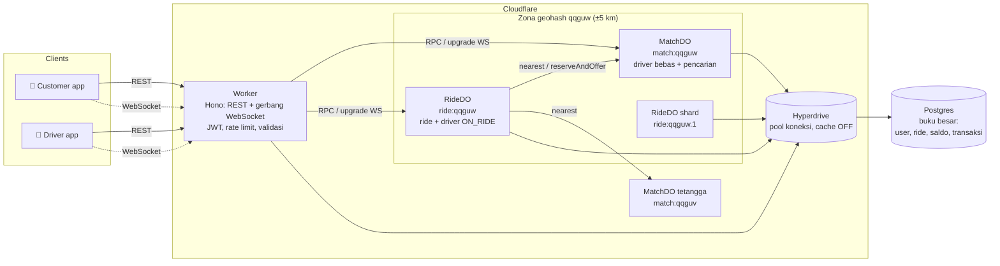
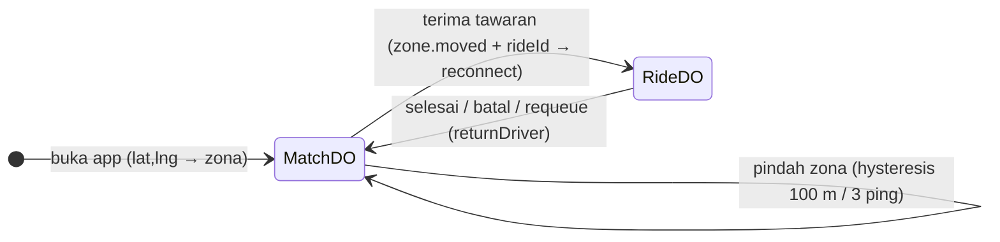
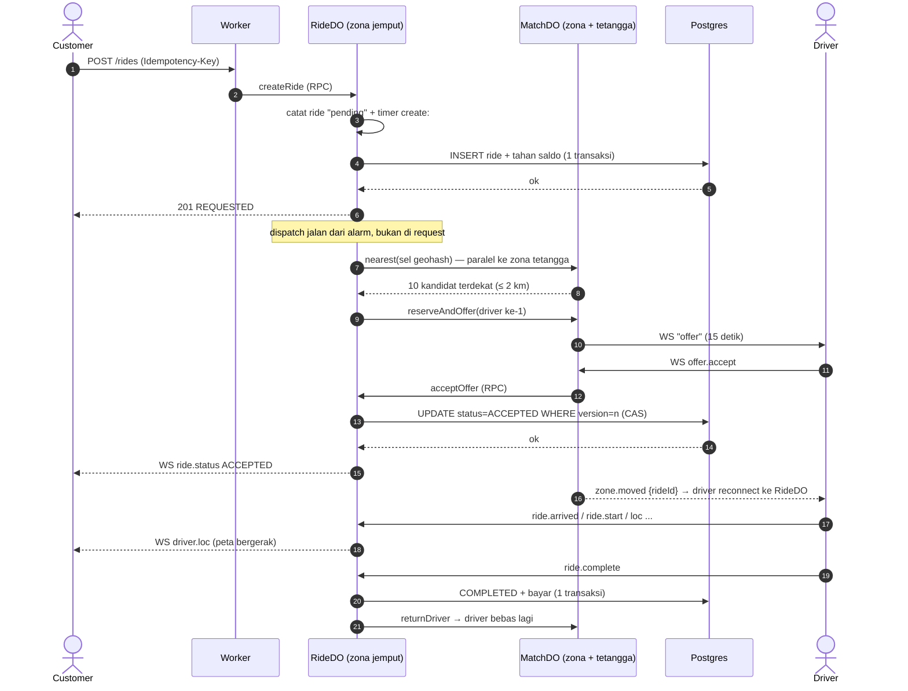
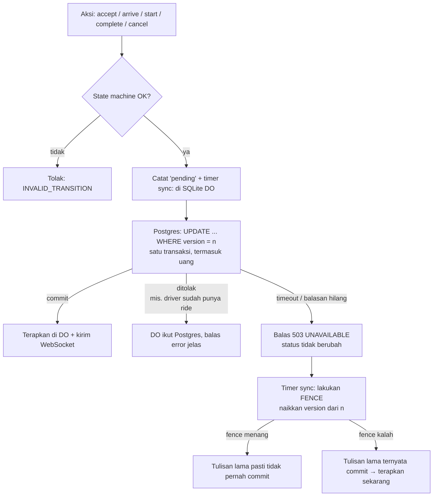

# Ride-Hailing di Atas Cloudflare Durable Objects

**Bahan presentasi arsitektur: Gojek/Uber clone (MVP)**

> Cara pakai dokumen ini: tiap bagian yang dipisah `---` kira-kira satu slide.
> Bagian "🎤 Catatan pembicara" untuk yang presentasi, bukan untuk ditampilkan.
> Diagram ditulis dengan Mermaid (tampil langsung di GitHub/GitLab, VS Code, Obsidian).

---

## 0. TL;DR (satu slide)

| Pertanyaan | Jawaban singkat |
|---|---|
| **What** | Backend ojek online: pesan ride, cari driver terdekat, tawarkan, lacak perjalanan, bayar (cash/wallet). |
| **How** | Cloudflare Workers sebagai pintu masuk, **Durable Objects (DO)** sebagai "petugas per wilayah", **Postgres** sebagai buku besar. |
| **Why DO** | Satu wilayah = satu aktor tunggal: tidak ada rebutan driver, WebSocket + timer + state ada di satu tempat, tanpa Redis/Kafka/server yang harus dijaga. |
| **Harga yang dibayar** | Semua yang melewati batas satu aktor (antar-zona, uang, aturan global) jadi rumit: butuh Postgres, protokol fence/CAS, timer pemulihan. Ada juga vendor lock-in dan batas throughput per aktor. |
| **Status** | MVP jalan end-to-end, 100+ test (unit, integrasi di workerd + Postgres, e2e Playwright). Belum production: belum OTP, belum load test. |

---

## 1. What: apa yang dibangun

Satu monorepo (pnpm + Turborepo):

```
packages/core              logika murni (tanpa I/O): geohash, matcher, state machine ride, tarif, settlement
packages/client            client bersama: REST, WebSocket auto-reconnect, tipe protokol, UI peta
apps/api                   Cloudflare Worker + 2 jenis Durable Object (MatchDO, RideDO) + Postgres
apps/simulator-customer    web app customer (React + MapLibre)
apps/simulator-driver      web app driver, dengan autopilot yang menggerakkan motor di peta
apps/e2e                   Playwright: test e2e + demo otomatis dua jendela
```

Fitur yang sudah jalan:

- Login (token JWT, belum OTP), estimasi tarif, pesan ride (idempotent).
- Cari driver terdekat, tawarkan **satu driver per kali** (15 detik), tolak → driver berikutnya.
- Status ride real-time lewat WebSocket: `REQUESTED → OFFERING → ACCEPTED → ARRIVED → ON_TRIP → COMPLETED`.
- Driver batal → otomatis dicarikan driver lain (maks 3 kali).
- Wallet: saldo ditahan saat pesan, dipotong saat selesai, dilepas saat batal. Komisi 20%.
- Rute perjalanan direkam (dirampingkan) ke Postgres.
- Driver "hilang" saat perjalanan (HP mati) → customer ditanya, lalu dibatalkan sistem.

🎤 *Catatan pembicara:* tekankan bahwa ini MVP tapi bagian "susah"-nya (rebutan driver, uang, database mati) sudah ditangani. Yang belum: OTP, payment gateway, admin panel, surge.

---

## 2. Kenapa ride-hailing itu susah?

Bukan CRUD biasa. Empat masalah inti:

| # | Masalah | Contoh nyata |
|---|---|---|
| 1 | **Rebutan sumber daya** | Dua customer pesan bersamaan, sistem menawarkan driver yang sama ke keduanya. |
| 2 | **Data lokasi yang sangat cerewet** | 10.000 driver online × ping tiap 5–10 detik = 1.000–2.000 update/detik, terus-menerus. |
| 3 | **Real-time dua arah** | Tawaran harus sampai ke HP driver dalam hitungan detik; posisi driver mengalir ke peta customer. |
| 4 | **Uang dan timer** | Tawaran kedaluwarsa 15 detik, pencarian 2 menit, saldo tidak boleh terpotong dua kali walau jaringan putus. |

Arsitektur klasik untuk ini biasanya: API stateless + **Redis** (GEO + lock) + **message broker** + **WebSocket gateway** terpisah + **scheduler/cron** + database. Banyak komponen yang harus dirawat.

---

## 3. Ide utama: "satu petugas per wilayah"

Analogi: kota dibagi jadi kotak-kotak (±5 km). Tiap kotak punya **satu petugas** yang:

- tahu semua driver bebas di kotaknya dan posisinya,
- satu-satunya yang boleh "mengunci" driver untuk ditawari,
- memegang telepon (WebSocket) ke driver-driver itu,
- punya jam alarm sendiri untuk tenggat waktu.

Karena **hanya ada satu petugas** per kotak dan dia mengerjakan satu hal pada satu waktu, rebutan driver **tidak mungkin terjadi** di dalam kotak itu. Tidak perlu lock, tidak perlu Redis.

Di Cloudflare, "petugas" ini adalah **Durable Object**:

| Sifat Durable Object | Arti untuk kita |
|---|---|
| Tepat **satu instance** per nama di seluruh dunia | `match:qqguw` hanya ada satu → satu pemilik state zona |
| **Single-threaded** | Reservasi driver atomik tanpa lock |
| Punya **storage SQLite** sendiri (transaksional, lokal) | State panas (driver, ride berjalan, timer) tahan restart |
| Bisa memegang **WebSocket** (Hibernation API) | Socket driver/customer langsung ke pemilik state |
| Punya **Alarm** | Timer tawaran, pencarian, retry, tanpa cron eksternal |
| Dipanggil lewat **RPC** dari Worker / DO lain | Antar-zona saling bertanya tanpa HTTP manual |

---

## 4. Gambaran besar



Tiga lapis, tiga tanggung jawab:

| Lapis | Komponen | Tugas | Sifat state |
|---|---|---|---|
| Pintu | **Worker** (`apps/api/src/index.ts`) | Cek token, validasi input, rate limit, arahkan ke aktor yang tepat | Stateless |
| Aktor | **MatchDO** (`match.ts`) | Driver bebas (`OFFLINE/AVAILABLE/RESERVED`), posisi, pencarian, reservasi | Panas, per zona |
| Aktor | **RideDO** (`ride.ts`) | Ride dari pesan sampai bayar: dispatch, status, timer, rute; socket customer + driver yang sedang ride | Panas, per zona (bisa di-shard) |
| Buku besar | **Postgres** via Hyperdrive (`db.ts`) | User, ride, saldo, transaksi, aturan lintas zona | Dingin, otoritatif |

---

## 5. Kenapa dua jenis aktor, bukan satu?

Versi awal hanya punya satu `ZoneDO` per zona. Lalu dipecah:

| | MatchDO | RideDO |
|---|---|---|
| Nama | `match:<zona>` | `ride:<zona>` atau `ride:<zona>.<k>` (shard) |
| Isi | Driver **bebas** | Ride + driver yang **sedang ride** |
| Beban utama | Ping lokasi driver idle, query "siapa terdekat" | Transisi status (menunggu Postgres), ping driver saat trip, socket customer |
| Bisa di-shard? | Tidak (satu kumpulan driver per zona) | **Ya**, `RIDE_SHARDS="qqguw=8,*=1"` |

Alasan pemisahan:

1. **Pekerjaan berbeda karakter.** MatchDO hampir semua di memori, cepat. RideDO banyak menunggu Postgres. Kalau digabung, satu Postgres lambat ikut menahan pencarian.
2. **Shard terpisah.** Zona sibuk (Sudirman jam pulang kantor) bisa punya 8 RideDO tapi tetap satu kolam driver.
3. **File lebih kecil.** `zone.ts` dulu 1.255 baris berisi semuanya.

Driver **berpindah rumah** selama hidupnya:



---

## 6. Data: apa disimpan di mana, dan kenapa

| Data | Tempat | Alasan |
|---|---|---|
| Posisi driver live | **Memori DO** + grid geohash-6, snapshot ke SQLite DO tiap 30 detik | Ping terlalu sering untuk ditulis. Hilang 30 detik terakhir saat restart = tidak masalah (driver ping lagi). |
| Status driver (`AVAILABLE`, `RESERVED`) | SQLite MatchDO | Harus konsisten untuk reservasi atomik |
| Ride berjalan (antrian kandidat, tawaran, pending transition) | SQLite RideDO | Detail dispatch yang hanya relevan bagi pemiliknya |
| Timer (`offer:`, `dispatch:`, `sync:`, `settle:`, ...) | Tabel `timers` di SQLite DO + **1 alarm** | DO hanya punya satu alarm, jadi semua timer di-multiplex |
| Status ride resmi, user, saldo, transaksi, hold | **Postgres** | Aturan lintas zona + uang butuh transaksi ACID global |
| Rute perjalanan | Buffer SQLite RideDO → batch ke Postgres tiap 1 menit | Hemat tulis, tidak hilang kalau Postgres mati |

**Prinsip:** *soft state* (lokasi) di memori, *hot state* (dispatch) di DO, *source of truth* (status ride, uang) di Postgres.

🎤 *Catatan pembicara:* aturan biaya dari tim (estimasi kasar untuk 10k driver, 100k ride/hari): menulis SQLite DO per ping ≈ $5.000/bulan; 1 DO per ride ≈ $7.000/bulan. Karena itu posisi di memori dan ride memakai shard tetap.

---

## 7. Alur satu ride



---

## 8. Mencari driver: geohash, bukan query spasial

- Zona = geohash presisi 5 (±5 km). Nama aktor = `match:<geohash>`.
- MatchDO menyimpan **grid geohash-6 di memori**: `cell → {driverId}`.
- Pencarian berlapis:
  1. Sel geohash-6 titik jemput + 8 tetangga.
  2. Kosong? Naik ke geohash-5 + 8 tetangga.
- Sel yang jatuh di zona lain → RPC ke MatchDO zona itu, **paralel** (`Promise.allSettled`: satu zona error tidak menggagalkan semuanya).
- Filter: status bebas, socket tersambung, ping < 45 detik, jarak lurus ≤ 2 km, ambil 10 terdekat.

Kenapa tidak PostGIS / Redis GEO? Karena data posisi **sudah ada di memori aktor** yang memiliki driver itu. Pencarian = lookup map, tanpa jaringan, tanpa tulis.

---

## 9. Bagian tersulit: konsistensi antara DO dan Postgres

**Masalah:** DO tidak bisa ikut transaksi bersama Postgres. Ada dua penyimpanan, dan jaringan bisa putus kapan saja.

Desain awal (DO dulu, Postgres menyusul lewat outbox) ternyata bisa membuat **outbox yatim**: DO mati di tengah flush → customer terkunci, saldo tertahan selamanya. Diganti dengan:

### "Postgres dulu, baru DO"



Hasilnya satu janji sederhana untuk client: **"ditolak" selalu berarti "tidak terjadi"**.

Trik pendukung:

- **Write-ahead di DO**: niat dicatat (+ timer pemulihan) *sebelum* bertanya ke Postgres, jadi DO yang mati di tengah jalan tetap menyelesaikan pekerjaannya saat hidup lagi (`rearmTimers`).
- **Lane per ride** (`serial`): aksi satu ride diantrikan. DO memang single-threaded, tapi setiap `await` (Postgres, RPC) membuka celah bagi pesan lain masuk. Lane menutup celah itu.
- **Idempotency di mana-mana**: `Idempotency-Key` untuk pesan & top-up, `reserveAndOffer` idempotent per ride, settlement aman diulang, batch rute pakai `seq` sebagai kunci.
- **Aturan global dijaga Postgres**: `one_active_ride` (per customer), `one_active_ride_driver` (per driver) sebagai partial unique index.

🎤 *Catatan pembicara:* ini slide paling penting untuk audiens teknis. Pesannya: DO menyelesaikan konsistensi *di dalam* satu aktor secara gratis, tapi konsistensi *antar* aktor dan dengan database tetap pekerjaan kita sendiri.

---

## 10. Hemat dan tahan banting

| Teknik | Di mana | Efek |
|---|---|---|
| Throttle ping 2 lapis (client ≥30 m / 10 s; server buang < 8 s & < 30 m) | `presence.ts`, `actor.ts` | Driver diam ≈ 1 pesan diproses / 8–10 detik |
| Throttle dicek **dari memori dulu**, sebelum baca SQLite | `ZoneActor.throttled` | Ping yang dibuang tidak menyentuh storage |
| WebSocket **Hibernation** + auto-response `ping→pong` | `actor.ts` constructor | Keepalive tidak membangunkan DO, durasi tidak ditagih saat idle |
| Reconnect dengan `known=1` | `client/socket.ts`, `/ws` | Badai reconnect setelah deploy = 0 query database |
| Backoff + jitter untuk close code 1001/1006/1012 | `client/socket.ts` | Ribuan client tidak menyerbu bersamaan |
| Rute dirampingkan (1 titik / 200 m, + belokan > 25 m) | `core/track.ts` | Trip 1 menit ≈ 15 titik, bukan 60 |
| Timeout Postgres (connect 5 s, statement 5 s, operasi 8 s) | `pg.ts` | Postgres lambat gagal cepat, tidak menggantung aksi |
| `locationHint` DO dekat region Postgres | `config.ts` `stubOf` | Tiap transisi menunggu Postgres → latensi kecil penting |
| Rate limit login (20/menit/IP) & WS (30/menit/user) | Worker | Cegah spam dan reconnect loop |

---

## 11. Skalabilitas: unit scale-nya adalah zona

- **Scale out = lebih banyak zona.** Setiap geohash-5 otomatis punya aktornya sendiri saat pertama dipakai; tidak ada provisioning.
- **Zona panas** → shard RideDO (`RIDE_SHARDS`). ID ride berisi rumahnya (`qqguw.3_<uuid>`), jadi routing tanpa lookup dan jumlah shard bisa diubah kapan saja tanpa memindahkan ride berjalan.
- **MatchDO tidak bisa di-shard** dengan cara yang sama (satu kolam driver per zona). Pilihannya nanti: zona lebih kecil (tapi driver lebih sering pindah zona & pencarian bertanya ke lebih banyak aktor).
- Batas kasar satu DO: dokumentasi Cloudflare menyebut soft limit sekitar **1.000 request/detik per objek** (tergantung berat kerja per pesan). Dengan ping idle tiap ±10 detik, secara teori satu MatchDO menampung ribuan driver; **belum diukur** (TODO C1: load test 1k → 5k driver per zona).

---

## 12. ✅ Kelebihan Durable Objects untuk kasus ini

| Kelebihan | Bukti di repo | Tanpa DO, kita butuh... |
|---|---|---|
| **Konsistensi lokal gratis**: satu writer per zona, reservasi driver atomik tanpa lock | `MatchDO.reserveAndOffer` | Redis `SETNX`/Lua script, distributed lock, atau `SELECT ... FOR UPDATE` |
| **State + WebSocket + timer di satu tempat** | `ZoneActor`: socket, `timers`, alarm, posisi | WS gateway + pub/sub (Redis) + scheduler (cron/queue) terpisah |
| **Hot state di memori, data lokasi tidak pernah ke DB** | `pos` + `grid`, snapshot 30 s | Redis GEO yang terus ditulis |
| **Storage lokal transaksional** (SQLite di dalam aktor) | tabel `rides`, `drivers`, `timers` | Tabel/keyspace tambahan di Redis/DB pusat |
| **Write-ahead + alarm = pekerjaan tidak hilang** saat crash/deploy | `rearmTimers`, `create:`, `sync:`, `settle:` | Job queue dengan retry + outbox |
| **Partisi alami per geografi**, aktor dibuat on-demand | `idFromName("match:<geohash>")` | Sharding manual, consistent hashing, service discovery |
| **Tanpa server untuk dirawat**: tidak ada patch OS, autoscaling, failover Redis | `wrangler deploy` | Tim ops / k8s / managed Redis |
| **Biaya ikut pemakaian**: zona sepi hampir gratis, WS idle hibernasi | Hibernation API | Node yang menyala 24/7 walau sepi |
| **Bisa dites lokal secara realistis** | vitest di `workerd` + Postgres nyata | Docker compose penuh (Redis, broker, gateway) |
| **Logika bisnis tetap portabel** | `packages/core` murni tanpa I/O | — |

---

## 13. ⚠️ Kekurangan Durable Objects untuk kasus ini

| Kekurangan | Dampak di proyek ini | Mitigasi yang sudah ada / masih terbuka |
|---|---|---|
| **Tidak ada transaksi lintas DO atau DO ↔ database** | Butuh protokol pending + CAS `version` + fence + timer pemulihan. `ride.ts` ±1.300 baris, sebagian besar untuk kasus gagal. | Sudah: Postgres-first + fence, test resiliensi. Biaya: kompleksitas tinggi, butuh engineer yang paham distributed systems. |
| **Satu aktor = satu thread = plafon throughput** | Zona super padat (stadion bubar, stasiun jam pulang) bisa jadi bottleneck MatchDO. | Sudah: shard RideDO, throttle ping dari memori. Terbuka: MatchDO belum bisa di-shard; belum ada load test. |
| **Single-threaded tidak berarti bebas race** | Setiap `await` membuka interleaving; bug halus (tawaran hilang, dispatch berhenti diam-diam) pernah terjadi. | Sudah: lane per ride (`serial`), keputusan selalu dari state tersimpan. |
| **Memori bisa hilang kapan saja** (eviction, deploy, restart) | Posisi live, sampler rute, peta `moved` hilang. Deploy = semua WebSocket putus. | Sudah: snapshot 30 s, reconnect + jitter + `known=1`, `rearmTimers`. Diterima: kehilangan ≤ 30 s posisi. |
| **Penempatan tetap** (dibuat sekali di dekat request pertama / location hint, tidak pindah) | Tidak semua PoP Cloudflare menjalankan DO; untuk Jakarta DO kemungkinan di region tetangga (mis. Singapura). Tiap transisi ride = DO → Postgres round-trip. | Sudah: `DO_LOCATION_HINT=apac`. Terbuka: ukur latensi nyata setelah deploy pertama. |
| **Hanya satu alarm per DO** | Semua timer harus di-multiplex sendiri. | Sudah: tabel `timers` + jalankan paralel maks 16, urut per ride. |
| **Tidak bisa query "semua DO"** | Tidak ada cara bawaan melihat semua zona, driver online se-kota, atau ride macet. Observability & admin sulit. | Sebagian: tabel `zones` di Postgres untuk enumerasi. Terbuka: dashboard ops, admin "paksa selesai". |
| **Geospasial dibuat sendiri** | Tidak ada Redis GEO / PostGIS; grid geohash, tetangga, hysteresis batas zona ditulis manual. | Sudah: `core/geo.ts` + test. Batasan: jarak lurus, bukan jarak jalan (ETA jalan = TODO C4). |
| **Driver berpindah aktor = reconnect** | Pindah zona & mulai/selesai ride memutus dan menyambung ulang socket; pesan di sela itu harus diteruskan. | Sudah: `zone.moved`, peta `moved` 60 s untuk meneruskan pesan, hysteresis 100 m / 3 ping. |
| **Vendor lock-in** | API DO, Hibernation, RPC, alarm spesifik Cloudflare. Pindah platform = tulis ulang lapisan `apps/api`. | Sebagian: logika murni di `packages/core`; PLAN memetakan peran ke Go/Rust/Bun (goroutine/tokio task per zona). |
| **Model biaya mudah "meledak" kalau salah pola** | Tulis SQLite per ping atau 1 DO per ride = ribuan dolar/bulan (estimasi tim). | Sudah: aturan biaya tertulis di TODO, ping di memori, shard tetap. |
| **Tetap butuh Postgres** | DO tidak menggantikan database relasional untuk uang & riwayat; ada dua sistem penyimpanan untuk dirawat. | Hyperdrive (pool, cache **dimatikan** agar saldo tidak basi). |

🎤 *Catatan pembicara:* kekurangan nomor 1 adalah yang paling mahal. DO membuat kasus "jalan normal" sangat sederhana, tapi kasus "jaringan putus di tengah" tetap harus dirancang manual, dan di sinilah sebagian besar kode dan test berada.

---

## 14. Dibanding alternatif

| Aspek | **Cloudflare DO** (repo ini) | Stateless API + Redis + broker | Actor di server sendiri (Go/Rust/Akka/Orleans) |
|---|---|---|---|
| Rebutan driver | Gratis (single writer per zona) | Lock/Lua di Redis | Gratis (actor per zona) |
| Lokasi driver | Memori aktor | Redis GEO (ditulis tiap ping) | Memori actor |
| WebSocket | Di aktor, hibernasi | Gateway terpisah + pub/sub | Di node, routing ke actor |
| Timer | Alarm (1 per DO, multiplex) | Delayed queue / cron | Timer in-process |
| Ops | Hampir nol | Sedang–tinggi | Tinggi (cluster, failover, rebalancing) |
| Throughput per partisi | Dibatasi 1 thread per DO | Horizontal, Redis jadi hotspot | Bisa multi-core per node |
| Penempatan | Ditentukan Cloudflare, tetap | Bebas | Bebas (bisa di Jakarta) |
| Lock-in | Tinggi | Rendah | Rendah |
| Biaya saat sepi | Sangat rendah | Node tetap menyala | Node tetap menyala |
| Kompleksitas kasus gagal | Tinggi (DO ↔ Postgres) | Tinggi (Redis ↔ DB) | Tinggi (actor ↔ DB) + cluster |

**Kesimpulan:** kompleksitas konsistensi dengan database ada di **semua** pilihan. DO "menang" di ops dan kesederhanaan jalur normal; "kalah" di kontrol (penempatan, throughput per partisi) dan portabilitas.

---

## 15. Kapan DO cocok, kapan tidak

**Cocok kalau:**

- Domain bisa dipartisi alami (geografi, room, dokumen, game match) dan sebagian besar interaksi terjadi **di dalam** satu partisi.
- Butuh real-time (WebSocket) + timer + state kecil yang konsisten per partisi.
- Tim kecil, tidak mau merawat Redis/Kafka/cluster.
- Beban per partisi masih di bawah ±ratusan–1.000 pesan/detik.

**Kurang cocok kalau:**

- Banyak transaksi **lintas partisi** yang harus atomik (mis. matching global, batch optimization seluruh kota).
- Satu partisi pasti sangat panas dan tidak bisa dipecah.
- Butuh kontrol penuh lokasi data (regulasi data residency ketat di region tertentu).
- Organisasi tidak mau terikat satu vendor.

Untuk ride-hailing MVP / skala kota: **cocok**. Untuk skala Gojek penuh (jutaan driver, batch matching, surge, ETA jalan), DO kemungkinan tetap berguna sebagai lapisan real-time per zona, tapi matching dan analitik akan butuh layanan terpisah (TODO C4/C5).

---

## 16. Status saat ini & yang belum

**Sudah:**

- Alur ride lengkap + wallet + requeue + driver-lost, Postgres-first dengan fence.
- Shard RideDO, throttle ping, hibernasi, reconnect murah.
- Test: unit `core` (geo, matcher, presence, state machine, tarif, settlement, track), integrasi `api` di workerd + Postgres (dispatch, resiliensi DB mati, requeue, shard, wallet, track), e2e Playwright.

**Belum (prioritas):**

| # | Item | Kenapa penting |
|---|---|---|
| A5 | Cek lokasi saat Tiba / Selesai | Sekarang driver bisa tekan Tiba → Mulai → Selesai dari mana saja (celah curang) |
| A7 | Validasi jarak tarif | Tujuan 1.000 km masih diterima |
| A9/A10 | No-show customer, akhiri trip di tengah jalan | Kasus operasional nyata |
| B1 | Login OTP | Siapa pun bisa login sebagai nomor siapa pun |
| B3 | Deploy pertama | Belum ada angka latensi DO ↔ Postgres nyata |
| C1 | Load test 1k → 5k driver per zona | Batas throughput MatchDO masih teori |

---

## 17. Key takeaways

1. **Durable Object = aktor tunggal per nama.** Untuk ride-hailing, nama = zona geohash → rebutan driver selesai tanpa lock.
2. **Pisahkan state menurut sifatnya:** lokasi di memori, dispatch di DO, uang & status resmi di Postgres.
3. **DO menyederhanakan jalur normal, bukan jalur gagal.** Konsistensi DO ↔ database tetap butuh desain eksplisit (pending, CAS, fence, timer).
4. **Pola akses menentukan biaya.** Salah satu pola (tulis per ping, aktor per ride) bisa membuat tagihan naik ratusan kali.
5. **Batas utamanya**: throughput satu aktor, penempatan yang tidak bisa diatur penuh, observability lintas aktor, dan lock-in. Semua ini harus diukur sebelum klaim siap production.

---

## Lampiran A: Glosarium

| Istilah | Arti |
|---|---|
| **Durable Object (DO)** | Objek stateful di Cloudflare; satu instance per nama, single-threaded, punya storage sendiri. |
| **Hibernation API** | DO boleh keluar dari memori sementara WebSocket-nya tetap terbuka; bangun lagi saat ada pesan. |
| **Alarm** | Satu jadwal bangun per DO; dipakai untuk semua timer. |
| **Geohash** | Kode string untuk kotak di peta; makin panjang makin kecil (5 ≈ 5 km, 6 ≈ 1 km). |
| **Hyperdrive** | Pool koneksi Cloudflare ke Postgres (cache dimatikan di proyek ini). |
| **CAS (compare-and-set)** | `UPDATE ... WHERE version = n`: hanya berhasil kalau belum ada yang mengubah. |
| **Fence** | Menaikkan `version` untuk memastikan tulisan lama yang "menggantung" tidak akan pernah commit. |
| **Idempotent** | Diulang berkali-kali hasilnya sama (tidak dobel). |
| **Shard** | Memecah satu zona ke beberapa RideDO supaya beban terbagi. |
| **Hysteresis** | Jeda/ambang sebelum pindah zona, agar GPS goyang di perbatasan tidak memicu reconnect bolak-balik. |

## Lampiran B: Peta file

| File | Isi |
|---|---|
| `apps/api/src/index.ts` | Worker: REST, gerbang `/ws`, routing ke aktor |
| `apps/api/src/actor.ts` | `ZoneActor`: dasar bersama (timer, socket, posisi, throttle, seam Postgres) |
| `apps/api/src/match.ts` | `MatchDO`: driver bebas, `nearest`, `reserveAndOffer`, hand-over zona |
| `apps/api/src/ride.ts` | `RideDO`: create, dispatch, commit/fence, settlement, rute, driver-lost |
| `apps/api/src/config.ts` | Config, nama aktor, shard (`rideHome`, `shardFor`) |
| `apps/api/src/db.ts`, `pg.ts` | Query Postgres, timeout, transaksi |
| `apps/api/migrations/` | Skema Postgres (`one_active_ride`, `wallet_holds`, `ride_track`) |
| `packages/core/src/` | Logika murni: `geo`, `matcher`, `presence`, `rideStateMachine`, `fare`, `settlement`, `track` |
| `packages/client/src/socket.ts` | WebSocket client: backoff + jitter, `zone.moved`, `known=1` |
| `apps/api/wrangler.jsonc` | Binding DO, Hyperdrive, rate limit, semua knob config |

## Lampiran C: Knob config yang menarik dibahas

| Var | Default | Makna |
|---|---|---|
| `ZONE_PRECISION` | 5 | Ukuran zona (±5 km) |
| `RIDE_SHARDS` | `1` | RideDO per zona, mis. `qqguw=8,*=1` |
| `OFFER_TIMEOUT_MS` / `RESERVE_TTL_MS` | 15 s / 20 s | Lama tawaran / reservasi driver |
| `SEARCH_TIMEOUT_MS` | 120 s | Batas pencarian sebelum `NO_DRIVER` |
| `LOC_MIN_INTERVAL_MS` / `_ON_RIDE_MS` | 8 s / 1 s | Throttle ping server |
| `HANDOFF_MARGIN_M` / `HANDOFF_PINGS` | 100 m / 3 | Hysteresis pindah zona |
| `DO_LOCATION_HINT` | `apac` | Penempatan DO dekat Postgres |
| `MAX_REQUEUES` | 3 | Driver batal maksimal sebelum sistem membatalkan |
